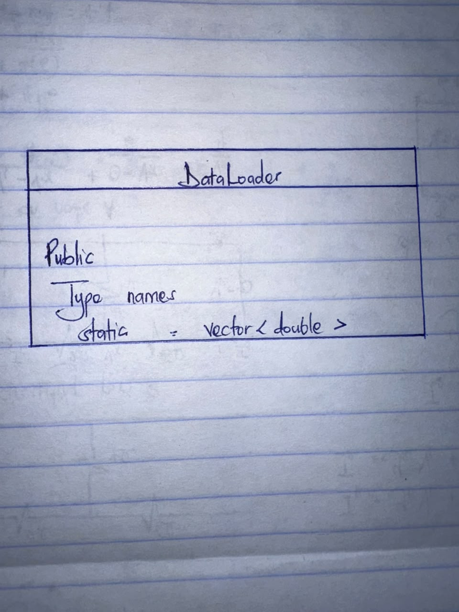

# Object-Oriented Programming Report: Week 03 — DataLoader

## 1. Encapsulation

`DataLoader` exposes a stateless public API, `DataLoader::loadCSV(const std::string&, const std::vector<std::size_t>&)`. CSV parsing helpers and temporary row/cell values are private to `src/DataLoader.cpp`'s implementation scope. Callers receive a numeric matrix without managing parsing state.

The optional column list selects and orders zero-based CSV fields; an empty list loads all columns. The first row is treated as a header. Invalid or non-finite numeric cells become NaN, while malformed quoting, row-width mismatches, empty files, and invalid column indices produce exceptions.

## 2. Inheritance

`DataLoader` is a standalone utility class and has no base or derived classes.

## 3. Polymorphism

The loader does not use virtual methods, overrides, or runtime polymorphism. Its static method is called directly without constructing an object.

## 4. Class Structure Summary

| Class | State | Public operation | Inheritance / polymorphism |
|---|---|---|---|
| `DataLoader` | None | `static loadCSV(filename, selectedColumns = {})` | None |

